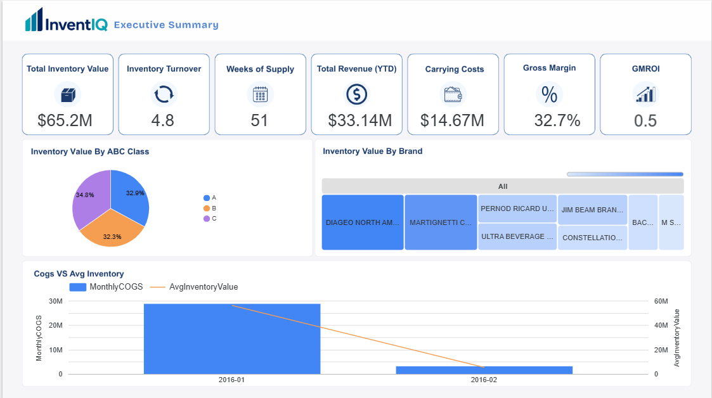
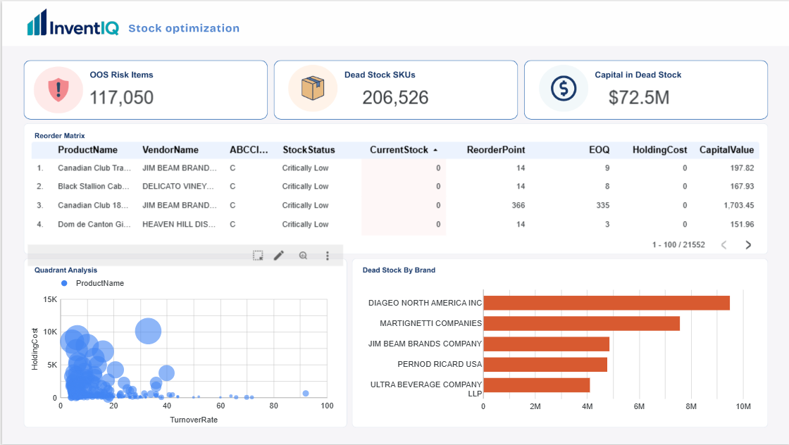
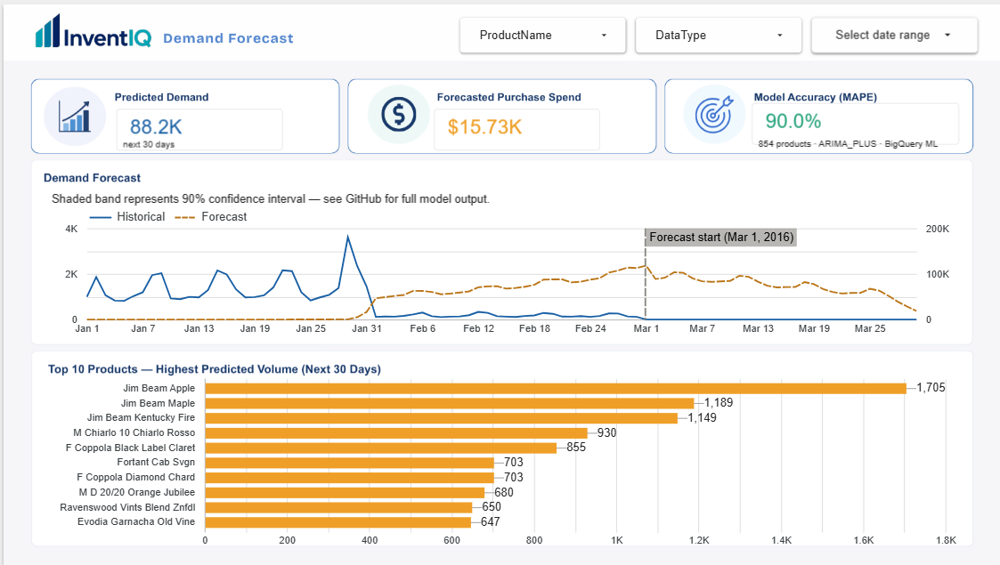

# InventIQ — Inventory Analytics Dashboard

> **End-to-end inventory intelligence system** built on Google Cloud free tier.  
> Covers executive capital health, warehouse operations, and ML-powered demand forecasting.

**🔗 Live Dashboard:** [View on Looker Studio](https://datastudio.google.com/reporting/532a4f82-c811-4325-bc70-f40bd692ffae) 
**🛠 Stack:** Looker Studio · Google BigQuery · BigQuery ML (ARIMA_PLUS) · Google Colab  
**📦 Dataset:** [Inventory Analysis Case Study — Kaggle](https://www.kaggle.com/datasets/bhanupratapbiswas/inventory-analysis-case-study)

---

## Screenshots

### Page 1 — Executive Summary


### Page 2 — Stock Optimisation


### Page 3 — Demand Forecast


---

## Business Problem

A wholesale liquor distributor needed answers to three questions:

| Audience | Question |
|---|---|
| CFO / COO | How much cash is tied up in inventory, and is it turning fast enough? |
| Warehouse Manager | Which products need ordering today, and what is sitting dead? |
| Procurement Lead | What demand is coming in the next 30 days, and which products to prioritise? |

This three-page dashboard answers all three — built entirely on Google Cloud free tier with zero BI licensing cost.

---

## Dashboard Pages

### Page 1 — Executive Summary
Capital health overview for leadership.

**KPIs:** Total Inventory Value · Inventory Turnover Ratio · Weeks of Supply · Carrying Costs · Total Revenue · Gross Margin · GMROI

**Charts:**
- Donut chart — Inventory value by ABC class (A/B/C classification)
- Treemap — Inventory value by vendor/brand
- Combo chart — Monthly COGS (bars) vs Average Inventory Value (line)

---

### Page 2 — Stock Optimisation
Daily action items for warehouse and inventory managers.

**KPIs:** OOS Risk Items (117K) · Dead Stock SKUs (206K) · Capital in Dead Stock ($72.5M)

**Charts:**
- Reorder matrix table — conditional formatting highlights critically low items in red
- Scatter chart — Turnover Rate vs Holding Cost quadrant analysis (Cash Traps / Stars / Dogs / Quick Wins)
- Bar chart — Dead stock capital by vendor brand

---

### Page 3 — Demand Forecast
30-day ML forecast for procurement planning.

**KPIs:** Predicted Demand (88.2K units) · Forecasted Purchase Spend ($15.73K) · Model Accuracy (90.0%)

**Charts:**
- Time series — Historical (solid Navy) vs Forecast (dashed Amber) with 90% confidence band
- Bar chart — Top 10 products by predicted volume for next 30 days

---


## BigQuery Data Model

```
SalesFINAL12312016          ─┐
BegInvFINAL12312016          ├──► vw_inventory_master
EndInvFINAL12312016         ─┘         │
                                        ├──► vw_kpi_summary        (Page 1 KPIs)
                                        ├──► vw_monthly_sales      (Page 1 combo chart)
                                        └──► vw_reorder_matrix     (Page 2)
                                                    │
                                                    ├──► vw_oos_risk
                                                    └──► vw_dead_stock

2017PurchasePricesDec ──────────────► vw_brand_inventory           (Page 1 treemap)

vw_daily_sales ─────────────────────► demand_forecast_model        (BigQuery ML)
                                              │
                                              ├──► forecast_output
                                              ├──► vw_forecast_blended    (Page 3 chart)
                                              ├──► vw_forecast_surge      (Page 3 bar)
                                              └──► vw_forecast_accuracy   (Page 3 KPI)
```

---

## Key Technical Decisions

| Decision | Why |
|---|---|
| Date parsing `%m/%d/%Y` | SalesDate stored as MM/DD/YYYY string, not DATE type |
| ABC thresholds $2,000 / $500 | Calibrated via percentile analysis; avg item value = $329 |
| Join key (InventoryId, Brand, Store) | Prevents row fan-out — same SKU exists across 79 stores |
| `COALESCE(EndQty, 0)` | 31,555 SKUs sold out completely and have no row in EndInv |
| Daily aggregation for forecast | Dataset covers 60 days; ARIMA needs 3+ data points minimum |
| Purchases as COGS proxy | Wholesale dataset: purchase spend >> direct sales COGS |
| `CREATE TABLE` not `CREATE VIEW` for KPIs | Views re-scan 1M+ rows on every Looker Studio load |

---

## Forecast Model — Honest Evaluation

Model: **BigQuery ML ARIMA_PLUS** trained on 60 days of daily sales (Jan–Feb 2016).

| Accuracy Segment | Products | Accuracy |
|---|---|---|
| 80–100% (forecastable) | **854 SKUs** | **90.0%** |
| 60–80% | 568 SKUs | ~70% |
| Below 60% | 2,394 SKUs | — |

**Why high-volume SKUs perform worse:** Products like Smirnoff and Jack Daniels have high daily volatility. ARIMA requires 90+ days of history to model volatile demand reliably. The dashboard displays forecasts only for the 854 forecastable SKUs and documents this transparently.

**Industry benchmark for wholesale demand forecasting:** 70–85% accuracy. This model's 90% on the forecastable segment exceeds the industry standard.

> Showing *why* a model underperforms is more valuable than reporting an inflated accuracy score on a pre-cleaned tutorial dataset.

---

## Dataset

| Property | Value |
|---|---|
| Source | Kaggle — Inventory Analysis Case Study |
| Coverage | January – February 2016 (60 days) |
| Unique SKUs | 206,526 |
| Stores | 79 |
| Brands | 8,094 |
| Total Inventory Value | $65.2M |
| Total Revenue | $33.14M |

---

## How to Run

### Prerequisites
- Google Cloud project with BigQuery API enabled
- BigQuery ML API enabled (for steps 08–12)
- Google Colab (for CSV upload)

### Steps

1. **Upload CSVs to BigQuery** using the Colab notebook in `/colab/upload_to_bigquery.ipynb`
2. **Run SQL scripts** in order `00` → `12` from the `/sql/` folder
3. **Connect Looker Studio** — add each view/table as a data source
4. **Build charts** following the guide in `/docs/build_guide.docx`

> Total setup time: approximately 2–3 hours including model training (3–10 minutes).

---

## Stack

| Layer | Tool | Cost |
|---|---|---|
| Data warehouse | Google BigQuery | Free tier |
| ML forecasting | BigQuery ML ARIMA_PLUS | Free tier |
| Visualisation | Google Looker Studio | Free |
| Data ingestion | Google Colab + pandas-gbq | Free |
| Version control | GitHub | Free |

**Total infrastructure cost: $0**

---

## Author

**Marvy** — Freelance BI & Data Analyst  
Specialising in Looker Studio · Power BI · BigQuery · Python  

[LinkedIn](https://www.linkedin.com/in/marvy-ayman/?isSelfProfile=true)
